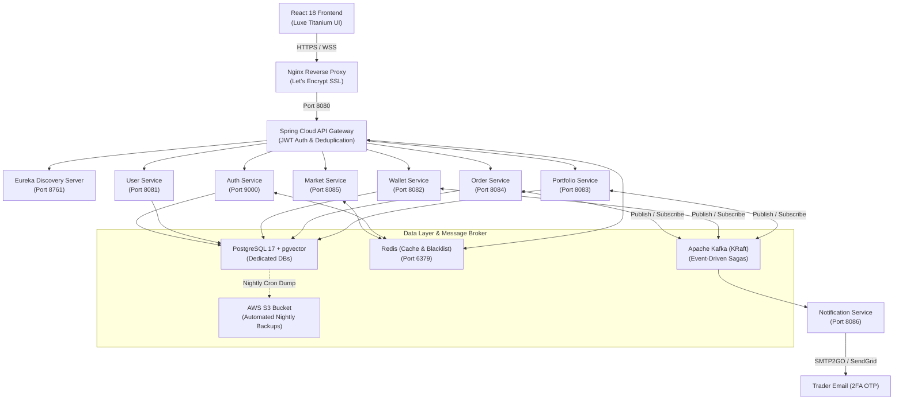

<div align="center">

# ▲ TradeFlow
### High-Performance Event-Driven Algorithmic & Paper Trading Platform

[](https://openjdk.org/)
[](https://spring.io/projects/spring-boot)
[](https://spring.io/projects/spring-cloud)
[](https://kafka.apache.org/)
[](https://redis.io/)
[](https://www.postgresql.org/)
[](https://react.dev/)
[](https://www.docker.com/)
[](https://aws.amazon.com/)

[**Live Demo API**](https://api.tradeflow.hbhanot.tech) &bull; [**Architecture**](#-system-architecture) &bull; [**Microservices**](#-microservices-ecosystem) &bull; [**Getting Started**](#-quick-start) &bull; [**Production Deploy**](#-cloud--production-deployment)

</div>

---

## 📌 Overview

**TradeFlow** is an institutional-grade, event-driven paper and algorithmic trading platform built with **Java 21**, **Spring Boot 3**, **Spring Cloud**, **Apache Kafka (KRaft)**, and **React 18**. It delivers real-time market data, Level 2 market depth, automated order execution, double-entry financial ledgering, and AI-driven portfolio insights while running on a highly cost-efficient cloud footprint.

---

## 🚀 Key Highlights & Capabilities

- **Event-Driven Choreographed Sagas (Kafka KRaft)**: Zero dual-write data hazards. Order creation, wallet balance reservation, limit matching, portfolio holding adjustments, and trade confirmation emails are coordinated via asynchronous event streams with automatic compensating rollbacks.
- **Automated Order Execution Engine**: Background worker monitoring pending Limit, Stop-Loss, and Bracket orders every 3 seconds against real-time price feeds, auto-filling orders when trigger conditions are met.
- **Level 2 Market Depth (Order Book)**: Real-time 5-level Bid/Ask ladder displaying volume depth, order counts, buyer vs. seller volume imbalance, and one-click price auto-filling.
- **High-Speed Redis Caching**: Sub-millisecond market price lookups, Upstox instrument key resolution, equity ticker caches, and JWT blacklist token validation.
- **Upstox API v2 & Real-Time Data**: Live Indian stock market price streaming (NSE/BSE), historic candle data, and financial news sentiment analysis.
- **Double-Entry Financial Ledger**: Immutable audit trail for deposits, withdrawals, trade holds, and margin releases with optimistic locking to prevent double-spending.
- **Automated Disaster Recovery Backups**: Automated nightly dumps of PostgreSQL databases with gzip compression, 7-day rolling local retention, and automatic sync to **AWS S3** via IAM instance roles.
- **Dual-Provider Notification Pipeline**: Transactional email dispatch powered by **SMTP2GO** with seamless fallback to **SendGrid**, featuring automatic OS-level "Copy Code" detection on iOS, macOS, Android, and Gmail.
- **Luxe Titanium Trading UI**: Premium glassmorphic React interface featuring customizable themes, interactive equity charts, offline demo mode, and mobile responsiveness.

---

## 🏗️ System Architecture



---

## 📦 Microservices Ecosystem

| Service | Port | Description | Primary Dependencies |
| :--- | :--- | :--- | :--- |
| **`api-gateway`** | `8080` | Entry point, JWT inspection, route load balancing, CORS normalization | Spring Cloud Gateway, Redis |
| **`discovery-server`** | `8761` | Dynamic service registration and heartbeat health monitoring | Netflix Eureka |
| **`auth-service`** | `9000` | User authentication, BCrypt hashing, JWT issuance, OTP generation | Spring Security, PostgreSQL, Redis |
| **`market_service`** | `8085` | Live Upstox API feed, L2 Market Depth, historical candles, news RSS | Redis, RestTemplate, WebSocket |
| **`order_service`** | `8084` | Order placement, automated limit/stop execution worker, saga orchestrator | Kafka, Spring Data JPA, Feign |
| **`wallet_service`** | `8082` | Virtual wallet management, balance reservations, immutable ledger | PostgreSQL, Kafka, Optimistic Locking |
| **`portfolio_service`** | `8083` | Stock holdings tracking, watchlist, Gemini AI portfolio summaries | PostgreSQL, Kafka, Gemini API |
| **`user_service`** | `8081` | Core user profile data and initial wallet bootstrapping | PostgreSQL, Feign |
| **`notification-service`** | `8086` | Asynchronous email dispatch (login OTP, trade fills, ledger updates) | Kafka, Thymeleaf, SMTP2GO, SendGrid |

---

## ⚡ Real-Time Trading Engine (Tier 1)

### 1. Automated Order Execution Worker
Located at [`OrderExecutionWorker.java`](tradeflow-backend/order_service/src/main/java/com/tradeflow/order_service/worker/OrderExecutionWorker.java), this scheduled background worker inspects all `PENDING` orders every 3 seconds:
- **BUY LIMIT**: Executes when `marketPrice <= triggerPrice`
- **SELL LIMIT**: Executes when `marketPrice >= triggerPrice`
- **STOP LOSS**: Triggers market order when price boundary is crossed
- **BRACKET**: Closes order on target profit or defensive stop loss

### 2. Level 2 Market Depth (5-Level Bid/Ask)
- **API Endpoint**: `GET /api/v1/market/depth/{symbol}`
- **Interactive UI**: Animated ladder showing real-time buyers vs. sellers imbalance percentage, volume depth bars, order counts, and click-to-autofill price directly in the trade ticket.

---

## 🔐 Event-Driven Saga Flow

```
[Trader] ──> Places BUY Order ──> [Order Service] (Status: PENDING)
                                         │
                         (Publishes OrderCreatedEvent)
                                         ▼
                                  [Kafka: order-created-topic]
                                         ▼
                                  [Wallet Service]
                                  ├── Has Balance?
                                  │   ├── YES ──> Reserves Funds ──> [Kafka: funds-reserved-topic]
                                  │   │                                       │
                                  │   │                                       ▼
                                  │   │                            [Order Execution Worker]
                                  │   │                            ├── Condition Met?
                                  │   │                            │   ├── YES ──> Status: COMPLETED
                                  │   │                            │               Publishes OrderCompletedEvent
                                  │   │                            │               Publishes NotificationEvent
                                  │   └── NO  ──> Rejects Order  ──> [Kafka: funds-rejected-topic]
                                                                              │
                                                                              ▼
                                                                   [Order Service] (Status: FAILED)
```

---

## 🚀 Quick Start (Local Development)

### Prerequisites
- **JDK 21** & **Maven 3.9+**
- **Node.js 18+** & **npm**
- **Docker & Docker Compose**

### 1. Clone & Setup
```bash
git clone https://github.com/Hardikbhanot/TradeFlow.git
cd TradeFlow
```

### 2. Configure Environment
Copy the example environment files:
```bash
cp tradeflow-backend/.env.example tradeflow-backend/.env
```
Fill in your database credentials, JWT secret, and optional Upstox/SMTP credentials.

### 3. Start Infrastructure via Docker
```bash
docker run -d --name tradeflow-postgres -e POSTGRES_PASSWORD=postgres -p 5432:5432 pgvector/pgvector:pg17
docker run -d --name tradeflow-redis -p 6379:6379 redis:alpine
docker run -d --name tradeflow-kafka -p 9092:9092 apache/kafka:latest
```

### 4. Build and Run Backend Services
```bash
# Build all modules
cd tradeflow-backend
mvn clean package -DskipTests

# Run Discovery Server first
java -jar discovery-server/target/*.jar &

# Run API Gateway and Services
java -jar api-gateway/target/*.jar &
java -jar auth-service/target/*.jar &
java -jar market_service/target/*.jar &
java -jar order_service/target/*.jar &
java -jar wallet_service/target/*.jar &
java -jar portfolio_service/target/*.jar &
java -jar user_service/target/*.jar &
java -jar notification-service/target/*.jar &
```

### 5. Launch Frontend
```bash
cd ../tradeflow-frontend
npm install
npm run dev
```
Open [http://localhost:5173](http://localhost:5173) in your browser.

---

## ☁️ Cloud & Production Deployment

TradeFlow is containerized and deployed on **AWS EC2 (Mumbai `ap-south-1`)**:

- **Reverse Proxy**: Nginx with automated Let's Encrypt SSL (`https://api.tradeflow.hbhanot.tech`).
- **CI/CD Pipeline**: GitHub Actions matrix workflow (`.github/workflows/backend-deploy.yml`) compiling Java 21 Spring Boot artifacts, pushing container images to GitHub Container Registry (`ghcr.io`), and auto-deploying via SSH.
- **Disaster Recovery**: Automated nightly cron script (`backup-databases.sh`) dumping PostgreSQL databases, applying gzip compression, and syncing to dedicated **AWS S3** storage (`s3://tradeflow-backups-hbhanot`).

---

## 🛡️ Security & Reliability

- **Stateless Authentication**: Signed HMAC-SHA256 JWT tokens with automatic Redis revocation blacklist upon logout.
- **Zero-Exposure Internal Microservices**: Only the API Gateway (`8080`) is exposed externally; internal services communicate securely inside the Docker network.
- **Strict Role-Based Access Control**: Sensitive administrative endpoints blocked from public gateway routing.
- **Optimistic Locking**: Prevents concurrency conflicts and race conditions on high-frequency wallet balance updates.

---

## 👨‍💻 Author

**Hardik Bhanot**  
- GitHub: [@Hardikbhanot](https://github.com/Hardikbhanot)
- Portfolio: [hbhanot.tech](https://hbhanot.tech)

---
*License: MIT*
